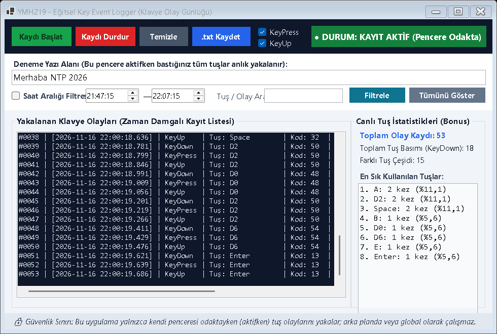
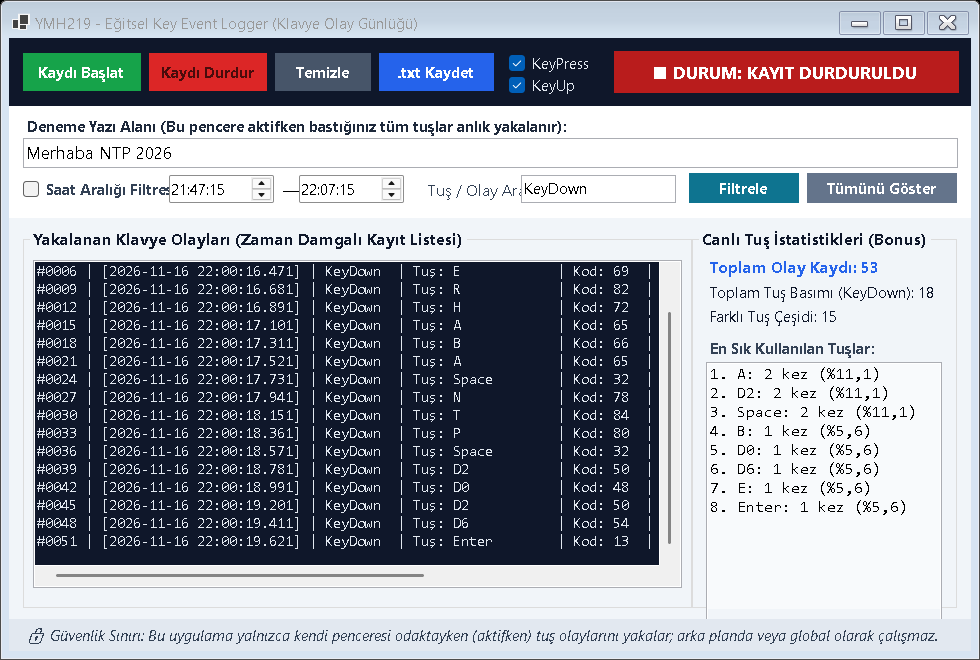

# YMH219-KeyEventLogger — Eğitsel Klavye Olay Günlüğü Uygulaması

**Nesne Tabanlı Programlama (YMH 219)** dersi 2. uygulama ödevi kapsamında geliştirilmiş, C# ve Windows Forms tabanlı **Eğitsel Key Event Logger** uygulamasıdır. Uygulama, **yalnızca kendi penceresi aktifken (odaktayken)** gerçekleşen `KeyDown`, `KeyPress` ve `KeyUp` klavye olaylarını yakalar, milisaniye hassasiyetinde zaman damgasıyla listeler, kullanım istatistiklerini çıkarır ve `StreamWriter` kullanarak `.txt` dosyasına kaydeder.

> **Kapsam ve Güvenlik Sınırı:** Bu proje kesinlikle bir sistem keylogger'ı değildir. Global keyboard hook (`SetWindowsHookEx`), arka planda gizli çalışma, başlangıçta otomatik çalışma, parola/kimlik bilgisi toplama veya ağ üzerinden veri gönderme **içermez**. Yalnızca formun kendi `KeyPreview` mekanizması ile pencere odaktayken çalışır.

---

## Kullanılan Teknoloji ve Kütüphaneler

* **Dil:** C#
* **Platform / Çerçeve:** .NET (`Windows Forms`)
* **Dosya İşlemleri:** `System.IO` (`StreamWriter`, UTF-8 karakter kodlaması)
* **Veri Sorgulama & İstatistik:** `System.Linq`
* **Harici NuGet Paketi:** Yok

---

## Sınıf ve Mimari Yapı (OOP Tasarımı)

* **`Models/KeyEventType.cs`:** Klavye olay türlerini (`KeyDown`, `KeyPress`, `KeyUp`) tanımlayan numaralandırma (`enum`).
* **`Models/KeyLogEntry.cs`:** Yakalanan her bir klavye olayının sıra numarasını, zaman damgasını (`Timestamp`), tuş adını (`KeyName`), sanal tuş kodunu (`KeyCodeValue`), yardımcı tuşları (`ModifiersText`) ve basılan karakteri (`CharacterDisplay`) kapsüller.
* **`Models/KeyUsageStatistic.cs`:** En sık basılan tuşların kullanım sayısını ve yüzdelik oranını temsil eden model sınıfı.
* **`Services/KeyLoggerService.cs`:** Kayıt başlatma/durdurma/temizleme işlemlerini, tarih-saat ve metin bazlı filtrelemeyi (`GetFilteredEntries`), en sık kullanılan tuş istatistiğini (`GetTopUsedKeys`) ve `.txt` dosyasına dışa aktarımı (`ExportToTextFile`) yöneten iş katmanı sınıfı.
* **`Forms/MainForm.cs`:** Kullanıcı arayüzünü, aktif/pasif görsel durum göstergesini, deneme metin kutusunu ve olay bağlamalarını yönetir.

---

## Kurulum ve Çalıştırma Adımları

1. Depoyu klonlayın:
   ```bash
   git clone https://github.com/duyareminezehra/YMH219-KeyEventLogger.git
   cd YMH219-KeyEventLogger
   ```
2. `YMH219-KeyEventLogger.sln` dosyasını **Visual Studio** ile açıp **F5** tuşuna basın veya terminalden çalıştırın:
   ```bash
   dotnet build
   dotnet run
   ```
3. **Kullanım:**
   * **Kaydı Başlat** butonuna tıklayın (Sağ üstteki gösterge yeşil renkte `DURUM: KAYIT AKTİF` olarak değişecektir).
   * Pencere aktifken klavyeden tuşlara basın veya **Deneme Yazı Alanı** içine metin yazın.
   * **Kaydı Durdur** ile yakalamayı durdurabilir, **Temizle** ile listeyi sıfırlayabilir, **.txt Kaydet** ile kayıtları rapor halinde diske kaydedebilirsiniz.

---

## Uygulamanın Temel Özellikleri

* **Asgari Gereksinimler:**
  * Pencere aktifken basılan tuşun adı, kodu, değiştirici tuş (`Shift`, `Ctrl`, `Alt`) ve zaman bilgisinin `ListBox` üzerinde anlık gösterilmesi.
  * **Kaydı Başlat**, **Kaydı Durdur** ve **Temizle** butonları.
  * Kayıtların `SaveFileDialog` ve `StreamWriter` ile `.txt` dosyasına kaydedilmesi.
  * Kayıt durumunu açıkça gösteren renkli durum rozeti (`KAYIT AKTİF` / `KAYIT DURDURULDU`).
* **Eklenen İsteğe Bağlı (Bonus) Özellikler:**
  * **Canlı Tuş İstatistikleri:** Toplam olay sayısı, toplam `KeyDown` sayısı, farklı tuş çeşidi ve en sık kullanılan tuşların kullanım sayısı + yüzdelik (`%`) dağılımı.
  * **Tarih/Saat ve Metin Filtreleme:** Başlangıç-bitiş saat aralığına veya tuş/olay adına göre kayıtları filtreleme.

---

## Ekran Görüntüleri

### 1. Kayıt Aktifken Canlı Olay Yakalama ve İstatistikler


### 2. Kayıt Durdurulduğunda ve Filtreleme Uygulandığında Görünüm


---

## Bilinen Sınırlamalar ve Geliştirme Notları

* Güvenlik ve etik sınırlar gereği uygulama simge durumuna küçültüldüğünde veya başka bir pencereye geçildiğinde hiçbir tuş olayı yakalanmaz.
* Arama kutusuna (`Tuş / Olay Ara`) filtre yazılırken yapılan tuş vuruşları, filtreleme deneyimini bozmamak adına olay listesine eklenmez.

---

## Öğrenci Bilgileri

* **Adı Soyadı:** Emine Zehra Duyar
* **Öğrenci Numarası:** 250541027
* **Ders:** YMH 219 — Nesne Tabanlı Programlama
